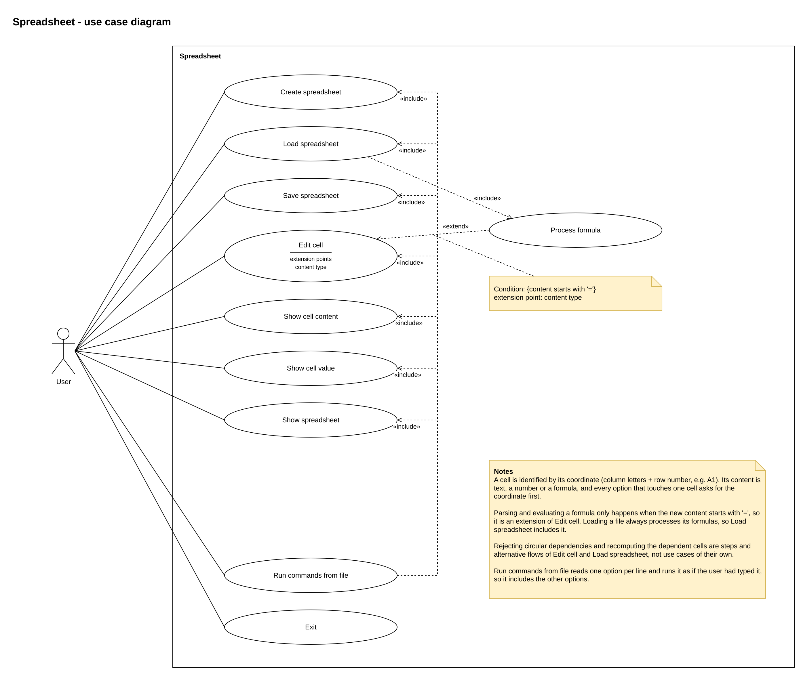
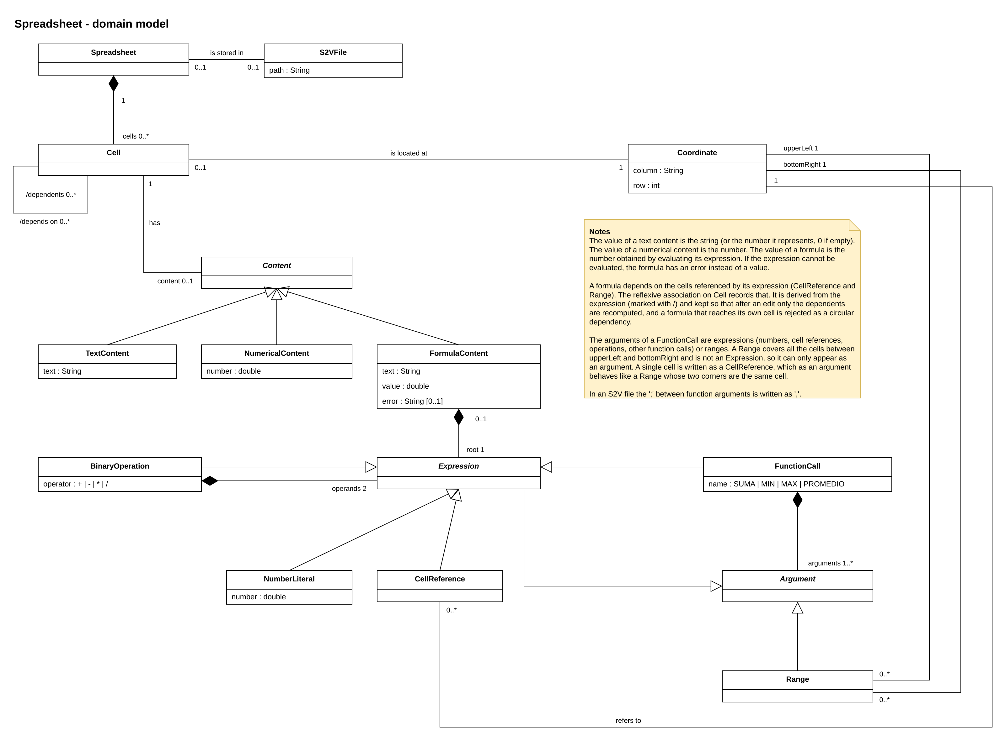

# Software Architecture project - Deliverable 1

Ka Man Fung Ng

12 November 2026

## 1. Use cases

For this project, the user of the spreadsheet is the only actor.

| Use case | Brief description | Primary flow | Alternative flow |
|---|---|---|---|
| Create spreadsheet | Starts a new empty spreadsheet. | The user chooses the option. The current spreadsheet is discarded and an empty one takes its place. | None. |
| Load spreadsheet | Loads a spreadsheet from an S2V file. | See 1.2. | See 1.2. |
| Save spreadsheet | Saves the current spreadsheet to an S2V file. | See 1.3. | See 1.3. |
| Edit cell | Sets the content of a cell (text, a number or a formula), or clears the cell if the content is empty. | See 1.1. | See 1.1. |
| Process formula | Extends *Edit cell* when the new content starts with `=`, and is included by *Load spreadsheet* for each formula of the file. Parses the formula, finds the cells it uses and computes its value. | The formula is checked for syntax errors (numbers, operators, parentheses, cell references, ranges and functions with arguments separated by `;`). The system checks that the formula does not use, directly or through other cells, the cell it is being set in. Then the expression is evaluated and the value goes back to the use case that asked for it. | A syntax error is reported and the cell is not changed. If the formula uses its own cell, directly or through other cells, the system shows the cells that form the cycle and the cell is not changed. The same happens if a referenced cell holds text that cannot be read as a number, or if the formula divides by zero. |
| Show cell content | Shows the content of a cell as it was written. | The user gives the coordinate. The content is printed as it was written, for example `TOTAL`, `4` or `=A1+B1`. An empty cell prints an empty string. | The coordinate is not valid. |
| Show cell value | Shows the computed value of a cell. | The user gives the coordinate. The value is printed. | The coordinate is not valid. If the cell holds a formula that could not be computed, its error is printed. |
| Show spreadsheet | Shows the values of all the cells at once. | The spreadsheet is printed as a table, with the column letters on top and the row numbers on the left, up to the last non-empty row and column. | If the spreadsheet is empty, only the headers are printed. |
| Run commands from file | Runs a list of commands stored in a text file. | The user gives the path of the file. Each line is run as one of the menu options with its arguments. | The file is not found. If a line is not a valid command or fails, the error is printed and the next line runs. |
| Exit | Leaves the program. | The program ends. Nothing is saved unless the user saved it before. | None. |

#### 1.1 Edit cell

**ID:** UC-01

**Brief description:** The user sets the content of a cell. If the text starts with `=` it is a formula, if it looks like a number it is a number, and anything else is text. If the content is empty, the cell is cleared. After the change, the cells that depend on the edited one are recomputed.

**Primary actor:** user.

**Secondary actors:** none.

**Pre-conditions:**
1. There is a current spreadsheet (new, or loaded from a file).

**Minimum guarantees:**
1. Either the cell has the new content and every dependent cell has been recomputed, or an error is shown and nothing changes.

**Success guarantees:**
1. The cell holds the new content and its value.
2. Every cell that depends on the edited cell, directly or through other cells, has been recomputed from the new content and holds either its new value or an error.

**Primary flow:**
1. The user gives the coordinate of the cell and the new content.
2. The system checks that the coordinate is valid (one or more letters followed by a row number from 1).
3. If the content starts with `=`, the system parses it, checks that it does not use the edited cell, directly or through other cells, and computes its value (*Process formula*).
4. The system stores the new content in the cell with its value and records the cells it depends on.
5. The system recomputes only the cells that depend on the edited cell, directly or through other cells. Each one is recomputed after the cells it uses.
6. The system shows the new value of the cell.
7. The use case ends.

**Alternative flows:**
- 2a. Invalid coordinate
  1. The system shows an error. Nothing changes.
  2. The use case ends.
- 2b. The content is text that contains `;`
  1. The system shows an error, because the S2V format could not store that text. Nothing changes.
  2. The use case ends.
- 3a. The formula has a syntax error
  1. The system shows the error and where it was found. Nothing changes.
  2. The use case ends.
- 3b. The formula introduces a circular dependency
  1. The system shows which cells form the cycle. Nothing changes.
  2. The use case ends.
- 3c. The formula cannot be evaluated (a referenced cell contains text that is not a number, or there is a division by zero)
  1. The system shows an error. Nothing changes.
  2. The use case ends.
- 5a. A dependent formula can no longer be computed with the new content
  1. The edit is kept. The system sets the value of that cell, and of the cells that depend on it, to an error and reports it.
  2. The use case continues at step 6.

#### 1.2 Load spreadsheet

**ID:** UC-02

**Brief description:** The user replaces the current spreadsheet with one read from a file in S2V format. Each line of the file is a row and the cells of the row are separated by `;`. Inside a formula, the `;` between the arguments of a function is written as `,` in the file.

**Primary actor:** user.

**Secondary actors:** none.

**Pre-conditions:**
1. None.

**Minimum guarantees:**
1. Either the spreadsheet of the file is the current spreadsheet with all its values computed, or an error is shown and the previous spreadsheet is kept.

**Success guarantees:**
1. The current spreadsheet has one cell for each non-empty field of the file, at the row of the line and the column of the field.
2. Every formula has been processed and every cell has its value.

**Primary flow:**
1. The user gives the path of the S2V file.
2. The system opens the file.
3. For each line, the system splits it by `;`. Each non-empty field becomes the content of the cell at that row and column. In a field that starts with `=`, the `,` between the arguments of a function are turned back into `;`.
4. The system computes the cells in the order of the file. Numbers and text are stored directly and formulas are parsed and evaluated (*Process formula*). If a formula uses a formula cell that has not been computed yet, that cell is computed first.
5. The system replaces the current spreadsheet with the loaded one and says how many rows were read.
6. The use case ends.

**Alternative flows:**
- 2a. The file does not exist or cannot be read
  1. The system shows an error. The current spreadsheet is kept.
  2. The use case ends.
- 4a. A field contains a formula that cannot be processed (syntax error, circular dependency, or a reference to a cell that cannot give a number)
  1. The system shows the coordinate of the cell and the error. The current spreadsheet is kept.
  2. The use case ends.

#### 1.3 Save spreadsheet

**ID:** UC-03

**Brief description:** The user stores the current spreadsheet in a file in S2V format, so it can be loaded again later.

**Primary actor:** user.

**Secondary actors:** none.

**Pre-conditions:**
1. There is a current spreadsheet.

**Minimum guarantees:**
1. Either the file contains the whole spreadsheet, or an error is shown and no partial file is left behind.

**Success guarantees:**
1. The file has one line per row, up to the last non-empty row, and loading it gives back the same contents.

**Primary flow:**
1. The user gives the path of the file to write.
2. For each row up to the last non-empty one, the system builds a line with the contents of its cells separated by `;`, up to the last non-empty cell of the row. Empty cells leave an empty field.
3. Numbers and text are written as they are. Formulas are written as their text, with the `;` between function arguments replaced by `,`.
4. The system writes the lines to the file, replacing it if it already exists, and confirms it.
5. The use case ends.

**Alternative flows:**
- 4a. The file cannot be written (the folder does not exist or there is no permission)
  1. The system shows an error.
  2. The use case ends.

## 2. Use case diagram

- The menu options are the use cases linked to the actor.
- When the new content starts with `=`, the formula has to be parsed, checked and evaluated. That is `Process formula`, an extension of `Edit cell` at the extension point `content type`, which only runs under that condition.
- `Load spreadsheet` includes `Process formula`, because every formula of the file has to be processed after loading it.
- Rejecting a circular dependency, recomputing the cells that depend on an edited cell and computing a loaded spreadsheet are not use cases of their own. The user never asks for them separately, so they are steps and alternative flows of `Edit cell` and `Load spreadsheet` (see 1.1 and 1.2).
- `Run commands from file` runs the options listed in a text file, one per line. Any of the options can appear in the file, so it includes all of them. It is there to test the program without typing the commands by hand.

## 3. Domain model diagram

A spreadsheet is a set of cells, each one at a coordinate and holding text, a number or a formula. On top of that, the model represents a parsed formula as a tree and keeps the dependencies between cells.

- `Spreadsheet` is composed of its `Cell`s, which do not exist outside it. `S2VFile` is the file it is stored in, and a new spreadsheet has none yet.
- Each `Cell` has one `Coordinate` (column letters and row number) and at most one `Content`. An empty cell has no content, so its string is empty and its number is 0.
- `Content` is abstract, with `TextContent`, `NumericalContent` and `FormulaContent`. A formula keeps its text and the value computed from it, or an error when it cannot be computed.
- The reflexive association on `Cell` records which cells a formula depends on. It is what allows recomputing only the dependents after an edit and detecting cycles.
- `FormulaContent` holds an `Expression` tree. `NumberLiteral` and `CellReference` are the leaves. `BinaryOperation` (`+`, `-`, `*`, `/`) is composed of two operand expressions and `FunctionCall` (`SUMA`, `MIN`, `MAX`, `PROMEDIO`) of one or more arguments.
- An `Argument` is either an `Expression` or a `Range`. A `Range` is the rectangle between two coordinates and is not an `Expression`, so it can be an argument of a function but not an operand or a whole formula. A single cell is a `CellReference`, which as an argument behaves like a range whose two corners are the same cell.
